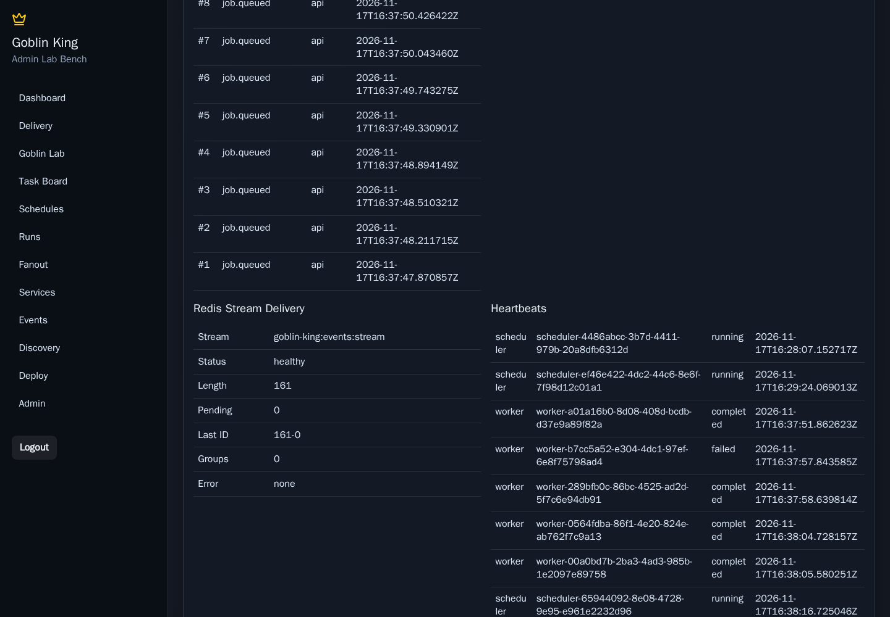
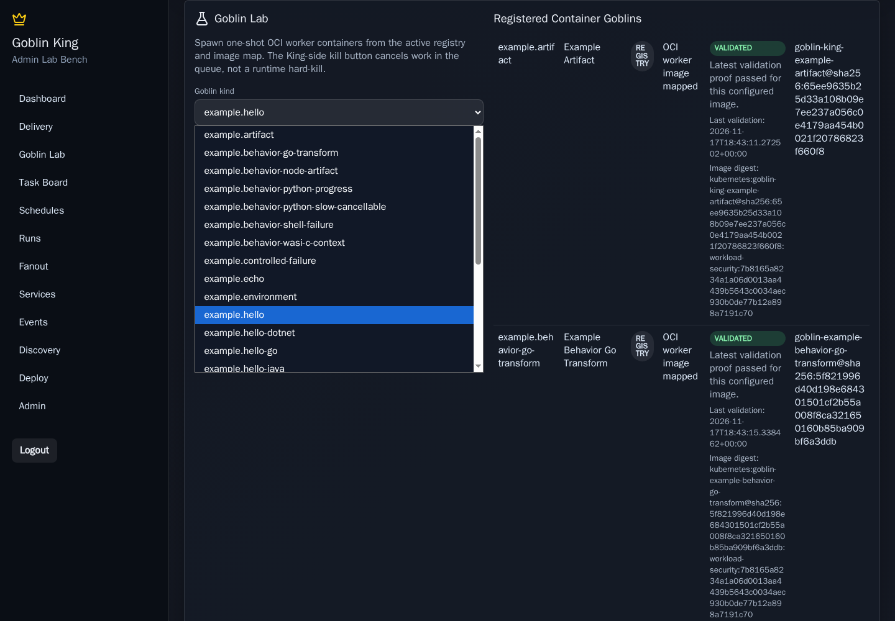
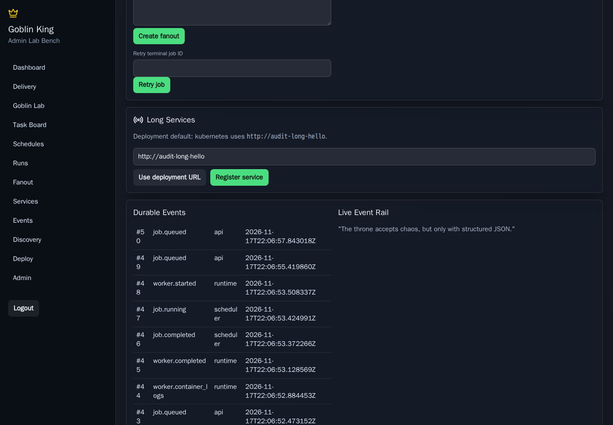
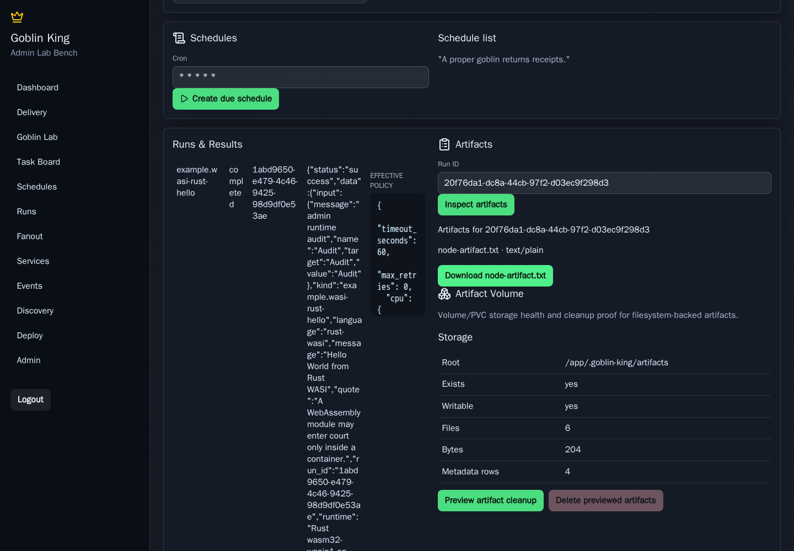

# Local browser acceptance evidence

I exercised the Docker and Helm admin interfaces twice against implementation
`437d2ca3debcdc6438dd15568fc62f4d2cc69ba6`. Browsers ran headlessly inside
containers without desktop input. Every registered one-shot kind was submitted
through the UI; the long-running example was checked through Services.

These are browser audit results, not a claim that the complete delivery acceptance
suite has finished. Cluster fault, storage, cleanup and retained-demo results are
reported separately. The delivery fixtures use a local GitHub API simulation;
synthetic reviews do not establish real GitHub review or App-installation evidence.

Helm evidence was verified using the unchanged verifier inside its audit Pod,
where the loopback endpoint is reachable. The packaged preparation helper verifies
CRI OCI-index aliases against the exact node-platform runtime manifest. Raw image
identities, hash checks and preparation attempts remain in the local report.

Only selected screenshots and non-secret execution identities are published here.
Credentials, installation values and full API responses remain outside Git.

## Run one: docker

Acceptance identity: `3bd4842c-4a7a-4d7a-8569-bee523364b00`.

| Kind | Result | Job | Run |
|---|---|---|---|
| example.artifact | completed | `9e25dfd7-06b6-4ed7-a1a8-c3e1c1bbf4c5` | `3e0f0baa-b33b-41ff-b9da-6766a6ae51c4` |
| example.behavior-go-transform | completed | `cd3c08b7-c2e2-4cbe-9518-9e1970e2fed2` | `21507a7a-6c65-403f-b601-65bdf1a9dc6f` |
| example.behavior-node-artifact | completed | `3c3e0150-6016-42fb-8a8c-37e964bb9f70` | `59c57ac7-60af-48a1-94df-c8e58968450f` |
| example.behavior-python-progress | completed | `f3ad23e9-2d9d-47ae-a4a4-9926fedc893c` | `f4b1e9f8-46d8-4894-87a6-38349b1ab115` |
| example.behavior-python-slow-cancellable | completed | `b593a9e5-6b42-4fbc-b743-391a8a92376a` | `cd7a9bb3-b066-4cdf-af35-97fbb0c54725` |
| example.behavior-shell-failure | documented controlled failure | `8bd1bb0d-f4a4-4ba1-ab82-bf9cac5fc3ba` | `9e9d4f31-4f7b-4268-a155-4a64309ea471` |
| example.behavior-wasi-c-context | completed | `55fb86e5-14a2-4704-898f-41c89eb4ddf5` | `45dbead9-c1a8-4f77-adbe-b3e9109777ee` |
| example.controlled-failure | documented controlled failure | `1aa774db-75da-4218-a712-08c6a4363371` | `3b05908e-08d7-4d34-9eac-05d1170407a4` |
| example.echo | completed | `3fc018d1-48fe-4c34-b7e2-a5c754e5be4c` | `f1eced23-2dec-4f04-9888-02ad371e55f7` |
| example.environment | completed | `18076516-a4ff-45bc-85dc-0c391cff94bf` | `88b1479d-8859-4873-9074-6cb870da7899` |
| example.hello | completed | `3ae0b5c2-ee8c-4e11-a305-b4c2f3c6d43a` | `2dbe3e15-f659-4958-901b-7a9b73d77256` |
| example.hello-dotnet | completed | `4d040f40-332d-4838-8a65-ae4a6a12d249` | `871c1820-a527-4f9f-8513-d6ee3e838105` |
| example.hello-go | completed | `d9581e9e-ed51-468f-a0f4-735df8b24b07` | `baa9a4fc-1b1f-4dbb-aaa2-75993a64db01` |
| example.hello-java | completed | `a04ccbba-02a2-4f51-b67a-3e484a95698a` | `8307d56e-e233-41bb-ac24-fe7a1f3ba09d` |
| example.hello-node | completed | `f1ee5316-2a7f-4a34-b5a3-87d83abe6b4a` | `79dbc757-cc01-4e5a-93ee-28e1b20a51f8` |
| example.hello-php | completed | `38f0465f-1e7f-449e-8cc7-8e4d3e7e0222` | `dde800ed-dd8b-4521-aa2e-d1fca6f40a43` |
| example.hello-python | completed | `b964429e-0f6a-4d01-b2d0-f00f8e3b0054` | `df0b6cf0-e81e-4467-bd63-f9700044d6a9` |
| example.hello-ruby | completed | `914a34ce-d7f6-41b3-9552-455374914c23` | `a06cdedb-d037-4cd0-a7e2-fd23090b71c9` |
| example.hello-rust | completed | `94d62526-44d9-445f-b0e1-ebfb11afd57c` | `eca1e62c-a4c9-499c-a951-02d0975b61ed` |
| example.hello-shell | completed | `3ac55417-4057-4cca-aea6-3381d40e5031` | `9971a5fc-8566-4808-97f8-f78f8462e1cf` |
| example.progress | completed | `fafb0957-7376-41ef-9350-009537ec0603` | `1646dcb7-ad69-4900-9d70-d98e190de169` |
| example.wasi-c-hello | completed | `ffab0e43-e1c1-4529-9b42-388439edbdb8` | `88bb40a4-b7f2-4b76-bd62-c3ac17bc9d55` |
| example.wasi-rust-hello | completed | `8dddfa9e-6772-4d6f-80e0-92259fa4949f` | `f8b3573f-c92d-4fef-b1a3-36d47d2c0fd9` |

I downloaded the returned artifacts and compared their bytes with the authenticated API. Both service probes returned HTTP 200 with advancing timestamps.

## Run one: helm

Acceptance identity: `3bd4842c-4a7a-4d7a-8569-bee523364b00`.

| Kind | Result | Job | Run |
|---|---|---|---|
| example.artifact | completed | `2314e25e-a0e2-485e-905f-797042cc6acb` | `7261fea4-5465-4ceb-866b-935e95676ff2` |
| example.behavior-go-transform | completed | `8b06b015-ca2c-4b71-adaa-96e99a6ab487` | `416e35ca-8892-49e2-9636-5eae353ae6b6` |
| example.behavior-node-artifact | completed | `7c5f76a8-219b-42ca-b237-ec2a6ac385d5` | `fafc017e-a9a8-449f-9fc1-7aeeae5697d7` |
| example.behavior-python-progress | completed | `506f9bb1-2861-44a4-bcfc-c95846d079fb` | `1a5a0c9b-cd7e-4104-9087-640b0fe22b86` |
| example.behavior-python-slow-cancellable | completed | `381f7386-a8d4-4bf0-9f04-237b12369399` | `63d068ec-eea4-4618-a326-c795fd5d83e4` |
| example.behavior-shell-failure | documented controlled failure | `8f8a34ac-99c4-497e-a7c5-9d02289840bf` | `c725b0e9-8fc3-49c9-ac0d-dd3d96bc491f` |
| example.behavior-wasi-c-context | completed | `3dba331e-53d9-47d9-9ae4-fbb45e29be32` | `fb258e3a-41af-4664-b335-fa03297c5295` |
| example.controlled-failure | documented controlled failure | `a5ec3537-99df-4bf1-998e-2bf67f1ce864` | `ac52905a-f518-41a6-ac5a-f8d0adfd01ba` |
| example.echo | completed | `6a454186-ae80-4be9-bd86-6ee2f0a08012` | `8009337f-d797-4904-b810-45d352f946f8` |
| example.environment | completed | `e6868222-f8cf-43e6-8ad3-a218e3712983` | `f7740f3d-21c7-4346-953b-1ac4262d543c` |
| example.hello | completed | `bc092542-7510-4085-bcc7-8dc451dc4ea3` | `f150c2b0-2c72-4239-9fb6-a047ae872555` |
| example.hello-dotnet | completed | `d4a464e9-0aa8-429a-b15a-3855d1d83d79` | `b5fd3bf0-c0a9-450e-a3ad-c2c712fe9e3d` |
| example.hello-go | completed | `001a256e-576d-4fc8-a4c6-601ef151c1cf` | `a7319582-7fff-4818-8a1d-048dcf238879` |
| example.hello-java | completed | `2bb26366-52c7-404a-9096-fbd5359d7c23` | `ba1eaa77-5a84-4d73-94bd-a16fe4bcab9c` |
| example.hello-node | completed | `ece1b435-68f6-461b-a8b6-a8ecbc98e718` | `7b0093bc-4ce3-4b28-883a-608c67ec8147` |
| example.hello-php | completed | `e4802885-fc6a-4353-8f66-d6615d2a74e7` | `f062a4f4-8fba-475d-b91e-602a7d0698bb` |
| example.hello-python | completed | `246ffc50-f892-4dd4-9e23-11bd3c2caf9e` | `16e9f212-6a45-4aff-a1a2-5a73ed4ec690` |
| example.hello-ruby | completed | `4430e161-a18d-46c3-b409-b51f7d20fb65` | `76a2fa79-29e8-435b-81a4-9e8ef8fedaf5` |
| example.hello-rust | completed | `50c44014-edcc-41de-8661-ee2c351d3100` | `a9a58996-d27e-4a75-8e38-76962e6d5d52` |
| example.hello-shell | completed | `450d1395-0dc8-451f-b856-e8f2db1d243b` | `c35d9ac8-52fb-4d4d-b779-f0fb525e0658` |
| example.progress | completed | `90b973e1-510e-4cf1-bda1-b7f33026e60e` | `be9d79aa-71ac-4a23-a7f3-fdb6d6fcc7c6` |
| example.wasi-c-hello | completed | `28467534-14e4-44d0-bf12-56692bdf151f` | `36e327f0-dcd7-49c5-8559-9346aab35f64` |
| example.wasi-rust-hello | completed | `2e581b4e-6271-48f3-a970-5b3135cc1f63` | `723a7a84-86eb-4b46-b204-21a07b8400cb` |

I downloaded the returned artifacts and compared their bytes with the authenticated API. Both service probes returned HTTP 200 with advancing timestamps.

## Run two: docker

Acceptance identity: `0dd10f3f-e407-4902-8a75-dc19dda72e1a`.

| Kind | Result | Job | Run |
|---|---|---|---|
| example.artifact | completed | `82c72e75-45ac-4311-bf6a-e792f654c1a4` | `caeb66ed-fc53-4374-b66e-b284a1623f6a` |
| example.behavior-go-transform | completed | `76773676-ee66-4cf9-964f-e300bbc2b5c3` | `1568f676-87a9-4edc-802f-4f96fe0124d2` |
| example.behavior-node-artifact | completed | `e968a6e7-602e-41f1-b9b6-cc4dc086860b` | `b182b810-7822-45fa-bb58-e6e128a58e85` |
| example.behavior-python-progress | completed | `7c44e13f-d388-4ccc-80c6-0275fe79a039` | `30cd2b22-d437-4db4-ae21-eb7027d1a9ec` |
| example.behavior-python-slow-cancellable | completed | `c6833c70-f553-4784-95f6-cf6f01f2dfc4` | `97e59dbb-44b9-4123-be5c-62321c1a0477` |
| example.behavior-shell-failure | documented controlled failure | `5c1ec093-b89b-4bfa-8dc3-d23b716d30f0` | `e336ca7f-86b4-4b9a-814b-d4dfa1fc4a93` |
| example.behavior-wasi-c-context | completed | `66f33ae8-584e-4cd4-ae58-b11b21647ad7` | `c68cb5cf-68ea-4300-ac69-16e78dbd2839` |
| example.controlled-failure | documented controlled failure | `a87583a0-c382-484c-aa59-4d1d10a1d3a6` | `cfc7b4e3-4f9f-4a6a-8d99-f4acfe5ee6a6` |
| example.echo | completed | `6a0aae4b-35ca-4954-b912-79b95eb0980b` | `caaf8324-d349-4432-b863-58efdcfcce2e` |
| example.environment | completed | `88133553-a1bd-4766-b0ce-cf6221ffc717` | `d10f5879-4f1b-4a59-a0d9-cb016b5a33b7` |
| example.hello | completed | `29e88397-4835-4666-b2cf-b855f3ae0c64` | `9f39543b-f2ff-4cc8-bf3a-145f660482b1` |
| example.hello-dotnet | completed | `b47ab474-ee99-47c5-898e-6d0d01e9fb1e` | `e3afed3d-3526-41f4-a680-6ba4ec35ca25` |
| example.hello-go | completed | `3f15db70-09c6-42d6-8c38-07ca191c546f` | `12413db5-4221-4a1c-b1d9-dd0700927ec7` |
| example.hello-java | completed | `c69b8c25-4c04-4da2-bc4f-2755863899ed` | `67fffd14-400e-42e4-bcb4-435f29a0605e` |
| example.hello-node | completed | `471bf809-bd21-4586-95f3-f92459e3e258` | `33a3ddf2-a456-430c-9bf6-72617b09d158` |
| example.hello-php | completed | `a0f22ec4-21d0-4121-93dd-ad96f13061bf` | `d7e44774-96b8-4cae-ab87-613e2d8689eb` |
| example.hello-python | completed | `b1a66ced-8b87-4cf9-948f-6499dc1e2a32` | `ff3be1a8-5f92-4e93-95c2-ba87d143ad74` |
| example.hello-ruby | completed | `bdc6d23e-50ff-4d94-9eb9-9d4ffc66e815` | `6274c588-fb80-44a4-889a-e331d5a00348` |
| example.hello-rust | completed | `363a2824-ffc8-4c24-a9fe-bdb00a0c8974` | `cb685cba-43b5-4865-8f85-9dc7e8271d66` |
| example.hello-shell | completed | `5adb1931-96bf-4b45-9c5d-74fbfa7891fe` | `67fc5699-04b2-47c0-b390-1f2e15512c9f` |
| example.progress | completed | `58ef5876-d717-4707-8e7f-f429a57131d7` | `09b2a06b-7dd9-4a0c-a9d0-7a43943e0496` |
| example.wasi-c-hello | completed | `4bb43cc7-ba60-444e-9ec6-043fd68b4780` | `e84a3a30-b280-4d05-a54c-671c8a9aa882` |
| example.wasi-rust-hello | completed | `0688dfe0-a383-45de-80ce-98e4defb4dfe` | `d81a5c90-0d69-4cff-877c-5558641094cf` |

I downloaded the returned artifacts and compared their bytes with the authenticated API. Both service probes returned HTTP 200 with advancing timestamps.

## Run two: helm

Acceptance identity: `0dd10f3f-e407-4902-8a75-dc19dda72e1a`.

| Kind | Result | Job | Run |
|---|---|---|---|
| example.artifact | completed | `3e2ae852-e992-416c-90fe-aaef940c09c2` | `b32194bc-159d-43e5-895e-938ac8982a3c` |
| example.behavior-go-transform | completed | `098f0926-da74-4c65-afbc-3f536f692d27` | `83623873-9449-4cbe-b774-6cc13211eac6` |
| example.behavior-node-artifact | completed | `119e5fc7-e1ab-46d7-a134-ccbd1e4f2379` | `1fc24dd5-783a-47b1-9370-9cab09aab5bd` |
| example.behavior-python-progress | completed | `f6918cc4-360c-434a-b651-a6efaf0de40d` | `12ec938e-5ff4-4c4c-a314-266b3bf86cb2` |
| example.behavior-python-slow-cancellable | completed | `4ff00191-d0e1-46a4-a389-b19d482622aa` | `0398db67-fcbc-459c-bf6d-50021cbd5452` |
| example.behavior-shell-failure | documented controlled failure | `501fac68-bdad-4d0c-a639-32dbd5f12eed` | `300e9ad1-c664-43d7-9d6c-ad76b5bb4e7e` |
| example.behavior-wasi-c-context | completed | `a61e78d7-f339-4a31-bd4c-58657f41cb03` | `ac3ee157-dcb6-432d-ab2d-31bf4192cd88` |
| example.controlled-failure | documented controlled failure | `6c8f374e-6508-46f3-901c-1f1be46f5483` | `97babd76-5aab-4964-b0dc-4052b6ccf2fc` |
| example.echo | completed | `6395df4d-e7e5-4313-9233-49b134bf183d` | `33b43586-4866-40c6-a7a3-cd4bcd8d5c5e` |
| example.environment | completed | `784c19a5-afaf-4f5f-a606-0a8c51447a9a` | `78473e05-7496-401c-83b4-a488c82d48bf` |
| example.hello | completed | `136e2365-bee5-4b2f-95d6-832a68320898` | `d8323d76-94fb-4fed-a85b-6e68bdbf39c4` |
| example.hello-dotnet | completed | `861b317e-fd50-4484-a29d-aefdb6b5e733` | `07c98359-2fd3-4e7a-84c6-274063a488e0` |
| example.hello-go | completed | `b46d365d-5613-45df-8dee-ca96b182ab06` | `dd42056c-90f2-449a-b912-80bc83a2ce73` |
| example.hello-java | completed | `171233c3-6af9-4f2d-a2e9-7310df83145e` | `47a74a9a-212f-4afb-b4ca-3ae3818a3a58` |
| example.hello-node | completed | `daec14c5-5f4f-4e7e-bb57-5abf164d3cf4` | `753fef1a-ee78-4550-aed1-0b03a1513a3e` |
| example.hello-php | completed | `982c97a6-fd55-4de2-84f9-0b53db65ad6a` | `5725bd1f-c3f9-468f-b164-765de1605133` |
| example.hello-python | completed | `d970affb-dcee-4278-adf7-7f73e21b15d7` | `61fa5b35-2330-47d4-b4e2-c834adf35036` |
| example.hello-ruby | completed | `723efec3-31d3-4642-a97b-592c9e6e7a28` | `bff5ad1a-27e6-40a6-a1a5-aa4d72f219bc` |
| example.hello-rust | completed | `553b18cb-0496-43ea-bbbb-8f0739ee7980` | `08a3359b-9f5c-4933-a24e-fe870a5573f2` |
| example.hello-shell | completed | `9eca1c5a-8ef9-45bf-a85b-09a577106fb4` | `5310f7af-cbb0-4d3b-9576-ad2d048351cc` |
| example.progress | completed | `4da4d583-7ee9-49db-9409-1689b67835f5` | `e91686d2-9280-4ab0-b7e6-74160d5b151d` |
| example.wasi-c-hello | completed | `defc1b87-162d-4bc2-8c1f-e90f8342c5b9` | `ff7ac740-bff7-4c30-8989-d4330edf6c33` |
| example.wasi-rust-hello | completed | `e012cb91-e1c5-4f35-b673-5f17c7a293ca` | `c1584de2-d8eb-46e2-ac1b-be6c57204e30` |

I downloaded the returned artifacts and compared their bytes with the authenticated API. Both service probes returned HTTP 200 with advancing timestamps.

