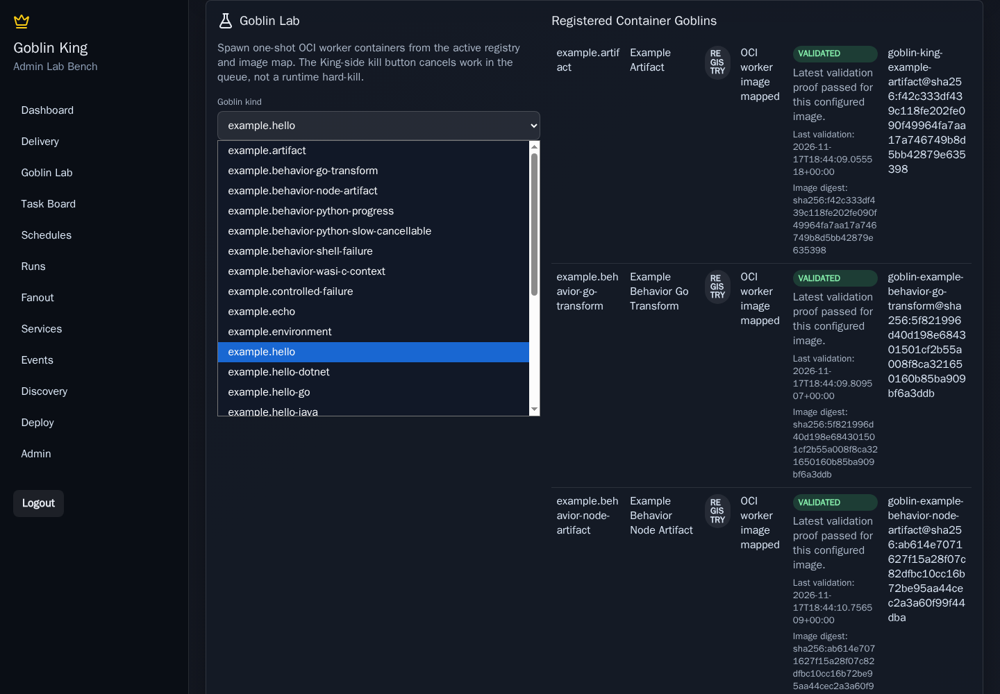
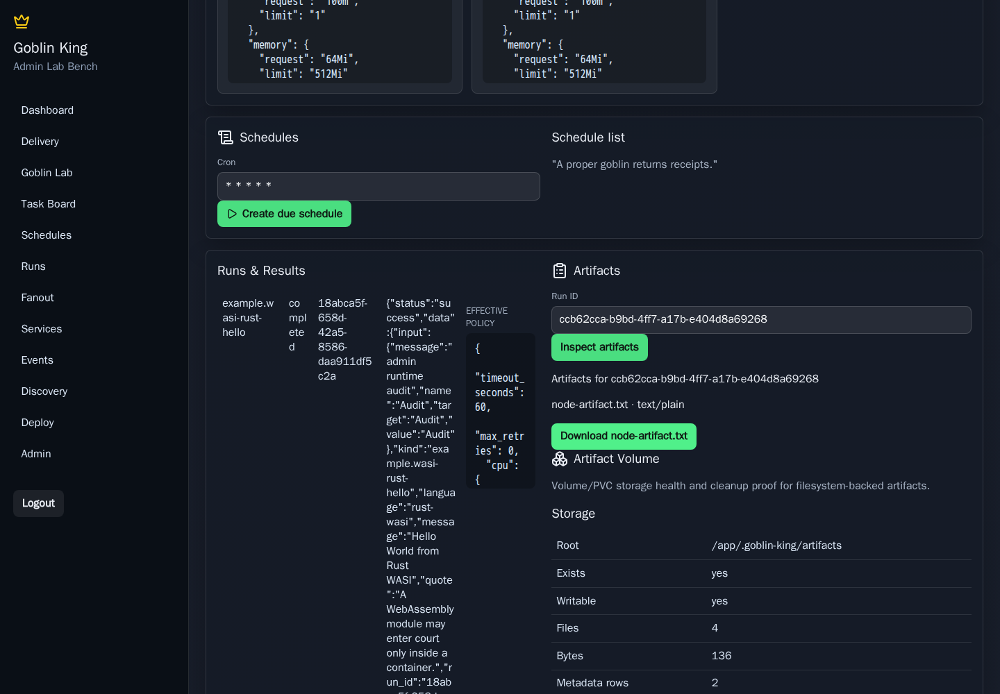
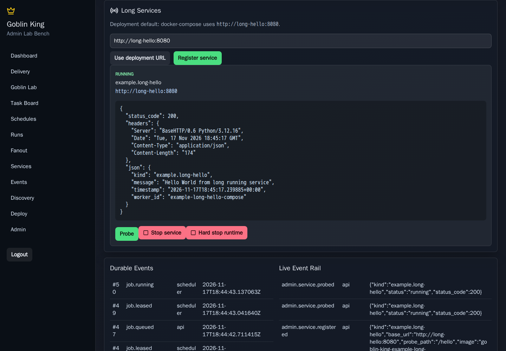
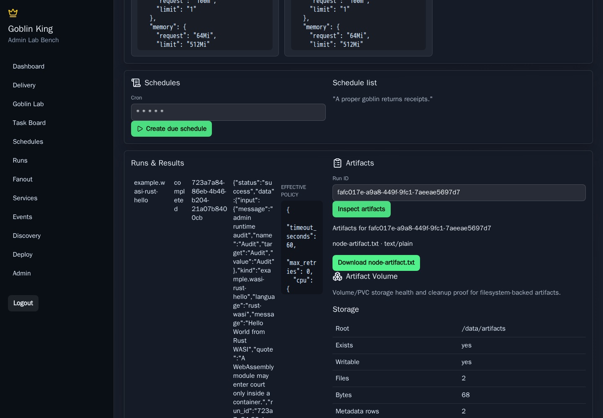
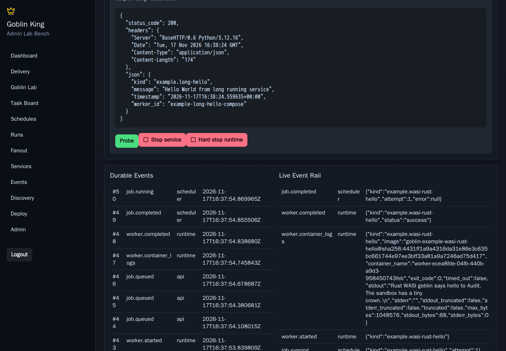
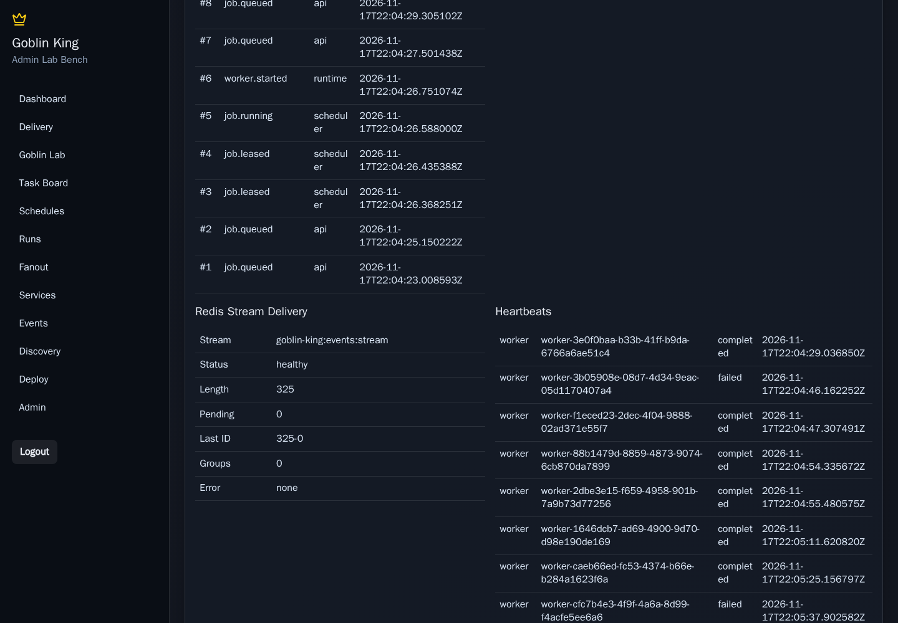
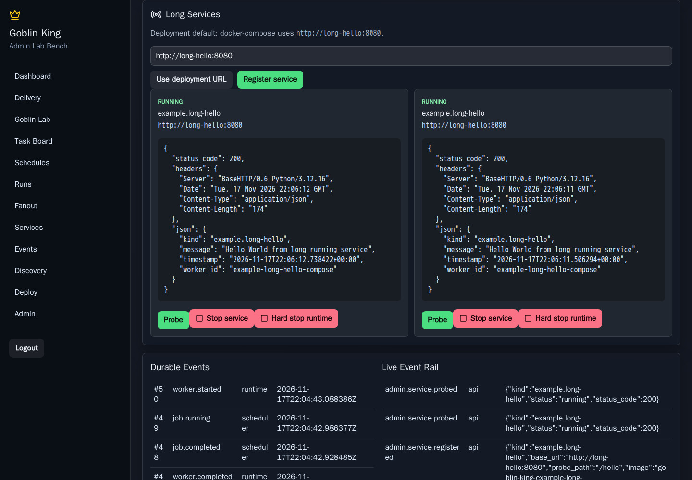
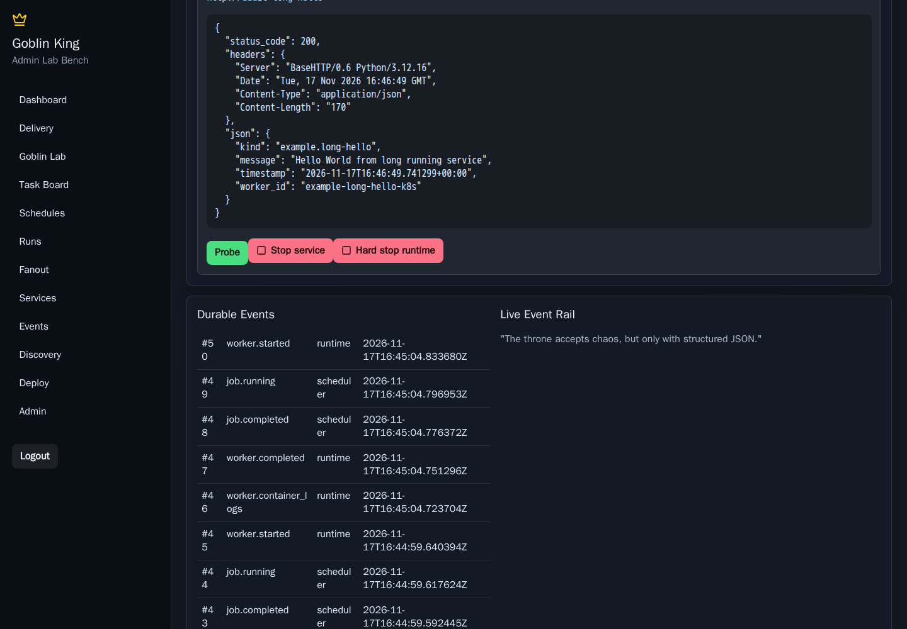
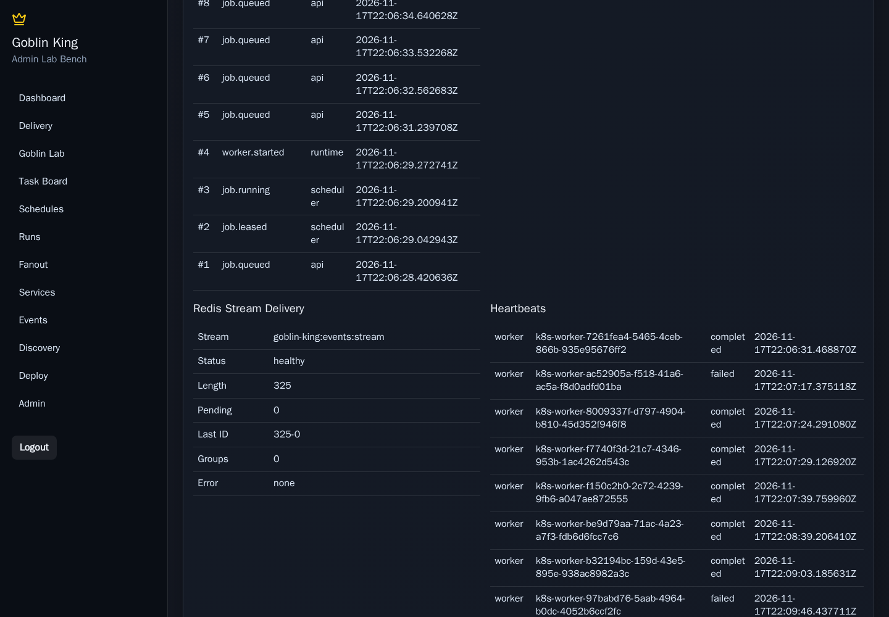

# Local browser acceptance evidence

I exercised the Docker and Helm admin interfaces twice against implementation
`64bdc1ac2705c0813641f9ae246c1e07a0110532`. Browsers ran headlessly inside
containers without desktop input. Every registered one-shot kind was submitted
through the UI; the long-running example was checked through Services.

These are browser audit results, not a claim that the complete delivery acceptance
suite has finished. Cluster fault, storage, cleanup and retained-demo results are
reported separately. The delivery fixtures use a local GitHub API simulation;
synthetic reviews do not establish real GitHub review or App-installation evidence.

Helm evidence was verified using the unchanged verifier inside its audit Pod,
where the loopback endpoint is reachable. Preparation required explicit validation
of a CRI OCI-index alias: both indexes selected the same Linux runtime manifest.
The original strict preparation failure and hash checks remain in the local report.

Only selected screenshots and non-secret execution identities are published here.
Credentials, installation values and full API responses remain outside Git.

## Run one: docker

Acceptance identity: `81e79240-f952-49de-9cc2-a65daa8bfcd5`.

| Kind | Result | Job | Run |
|---|---|---|---|
| example.artifact | completed | `590e61e0-7bac-4aa0-b04f-531ac8028de6` | `a01a16b0-8d08-408d-bcdb-d37e9a89f82a` |
| example.behavior-go-transform | completed | `ea3cfb4c-c899-4722-a118-26d8b4d4c415` | `bdfb582b-2408-4c1c-b181-899d66fd2586` |
| example.behavior-node-artifact | completed | `149839d1-3cf8-445f-924b-5d81f2af6040` | `ccb62cca-b9bd-4ff7-a17b-e404d8a69268` |
| example.behavior-python-progress | completed | `056b8659-c03e-4a2f-99b3-8f7c5c254b33` | `12124f33-870d-4626-bd90-c26e6b077410` |
| example.behavior-python-slow-cancellable | completed | `24d56f5c-1d18-4305-9cad-3f7093834b97` | `61c187a2-57f0-496c-bf17-55e15f34d962` |
| example.behavior-shell-failure | documented controlled failure | `46467455-4013-4089-b518-771084b28bb2` | `ea62a8ec-a9e9-4110-8348-d584c2ef6a18` |
| example.behavior-wasi-c-context | completed | `b3299b08-ff66-4564-a752-7ca6c7b06616` | `3f5ff5ce-52eb-426e-908c-01b33b3e3001` |
| example.controlled-failure | documented controlled failure | `3b38e29f-abea-4fa7-9c0e-da582ab97e33` | `b7cc5a52-e304-4dc1-97ef-6e8f75798ad4` |
| example.echo | completed | `51422d68-023c-4710-afff-47e0a3dbdefd` | `289bfb0c-86bc-4525-ad2d-5f7c6e94db91` |
| example.environment | completed | `84a7d572-7f40-43a1-82eb-584c9ce17006` | `0564fdba-86f1-4e20-824e-ab762f7c9a13` |
| example.hello | completed | `ef53d9cf-5d57-4ed4-a921-11cbf16b44c8` | `00a0bd7b-2ba3-4ad3-985b-1e2097e89758` |
| example.hello-dotnet | completed | `588fbcf6-3801-4d74-a123-a29e816baa63` | `b38717ca-d0d6-4e56-ba3c-e892319a9de9` |
| example.hello-go | completed | `c7414f5c-ae04-4379-a458-b85c4de9791b` | `21830eca-0e2d-47a3-ab0b-b5e71fb27ece` |
| example.hello-java | completed | `9b0f90f2-93f7-456f-99dd-0fa2bc49dfac` | `3c0ec8fe-8b7e-4d29-94f7-630c5e6e421a` |
| example.hello-node | completed | `5cac92fb-f74e-4020-92bb-a58257452c39` | `6272d771-7f5a-4a91-b5f5-db6facd67d2b` |
| example.hello-php | completed | `135ee48b-4559-4f5b-be12-0bd441ea3044` | `22b6702a-0679-4140-9590-3175ddaf705c` |
| example.hello-python | completed | `e67f51d4-5bae-4d79-8567-07a7e50cb280` | `5e5e3fde-703f-4093-9756-4327e5c1453c` |
| example.hello-ruby | completed | `70ac231d-7094-4c84-a9d9-6a7d2d0f8c14` | `5b84bc01-bddf-497e-9a79-1cc547ca47b0` |
| example.hello-rust | completed | `7aad2916-018d-4fcc-ae00-694912078671` | `73f97143-26b5-4946-abc5-33ea0bff0b1d` |
| example.hello-shell | completed | `8d84e0a9-b05c-4f6d-9e49-61b6f1657104` | `1f6059db-82eb-4102-8004-b8891c7aee91` |
| example.progress | completed | `49b0969c-2b55-4d9c-98ca-4ea16981ff4a` | `2bc60bab-428b-489f-9c37-f88cd968c275` |
| example.wasi-c-hello | completed | `cf2a2ad4-e1ed-433f-ac6e-dbb1c53a8bfd` | `682dfc66-896c-404e-9d9b-fa72dd1040ac` |
| example.wasi-rust-hello | completed | `8f48ac01-b134-4a42-8225-3e75ca49c51f` | `18abca5f-658d-42a5-8586-daa911df5c2a` |

I downloaded the returned artifacts and compared their bytes with the authenticated API. Both service probes returned HTTP 200 with advancing timestamps.

## Run one: helm

Acceptance identity: `81e79240-f952-49de-9cc2-a65daa8bfcd5`.

| Kind | Result | Job | Run |
|---|---|---|---|
| example.artifact | completed | `c681a5f2-a3c0-4bd5-b05e-57f3528ba0ef` | `008d99f3-6f92-4367-bdfa-2efd00c1e550` |
| example.behavior-go-transform | completed | `c565d87b-b623-488c-841d-803e3fb400a5` | `c5cb4d42-3132-4e49-97d2-a47a1aa62d82` |
| example.behavior-node-artifact | completed | `5674e17b-450c-4125-b9b2-ae7bad8b0ff3` | `a31273da-fd7f-4197-8553-5f334353652c` |
| example.behavior-python-progress | completed | `06568ae9-9a10-4f39-962a-ea309597a4f0` | `f80598bb-e6f1-4d3a-b072-f1cba6880787` |
| example.behavior-python-slow-cancellable | completed | `15cb1fcf-578b-43f6-8470-dc1b204234a3` | `abcfcc4c-6571-4c10-bb1c-d161515316cc` |
| example.behavior-shell-failure | documented controlled failure | `93186e64-09e9-4fab-9cbc-9ef4b29a86e1` | `76b80362-fd71-4cc7-ae0e-1fa06f1343e2` |
| example.behavior-wasi-c-context | completed | `dc03043c-4ed2-49d0-84eb-4d7db22c137c` | `33acadc0-3bba-4636-bdf4-c543928a5e49` |
| example.controlled-failure | documented controlled failure | `f24dea69-1fde-4785-a3ab-a730362c58af` | `9fa221e3-d1b9-4f03-b039-b2443d5b15d6` |
| example.echo | completed | `e2c0e142-1207-41ee-8bd3-ad2f2fbdb486` | `77decb77-1893-485d-adfc-d209de5a997a` |
| example.environment | completed | `24825307-ebf6-4cf5-9d20-a6066a6f0574` | `40ab7b39-2deb-45f4-998e-bcaaa9b14099` |
| example.hello | completed | `9281720f-2b56-49c3-992f-21b3f2cf22ba` | `76408527-7f30-4dc8-9903-8241c7a1d1b9` |
| example.hello-dotnet | completed | `ac1713d8-be78-43a3-b54f-996313305872` | `3ee400ba-b3be-424f-9a77-7b44d6a0d415` |
| example.hello-go | completed | `986e5940-9b0d-4305-b87e-5116d7e4e783` | `f93b464c-f27d-40d5-8f5b-e892597a2476` |
| example.hello-java | completed | `204ff1ce-6023-4341-9375-8c774af04761` | `091c0378-acc7-4497-a1b2-224e87d0f29b` |
| example.hello-node | completed | `7c7520b9-00ac-4612-b5ad-ade46df9de03` | `34b933a0-4dd3-4993-aec9-87866c1a27af` |
| example.hello-php | completed | `039912c7-5fa7-4ffd-aaf0-04adaa2c67e0` | `0643d229-34d7-4845-8a84-68bca138537a` |
| example.hello-python | completed | `ee36abb8-7534-450d-9960-51addd2807cc` | `e2be0c5b-05ff-47c5-877b-a3ad1c10c154` |
| example.hello-ruby | completed | `c9edfccd-432c-480d-86f4-b426007a2953` | `89cefbf5-6cc8-4d7d-83d0-6f76de6ee0d8` |
| example.hello-rust | completed | `5edf78c4-f447-4f24-a642-5dc3e8fbb49c` | `06150172-29ef-49b4-8e91-8a4095c8473c` |
| example.hello-shell | completed | `3903e60c-0c5b-4055-8b81-fc205153c126` | `c133d53a-5080-430c-b223-91fca06727a2` |
| example.progress | completed | `951bb996-0dce-4fb0-8da4-91005f3d2550` | `b4881da3-67b4-47ab-96e5-f817d9830583` |
| example.wasi-c-hello | completed | `20ebe36e-b975-4d80-928c-13e3ff638c33` | `70d43bb7-1661-4db3-8370-1862e9766b3a` |
| example.wasi-rust-hello | completed | `2ca821d5-6b2e-419e-88c4-5bde831cdb3f` | `4a35b2f8-a147-4cd9-9344-f65f46783ec4` |

I downloaded the returned artifacts and compared their bytes with the authenticated API. Both service probes returned HTTP 200 with advancing timestamps.

## Run two: docker

Acceptance identity: `6c40ec99-c340-4e9a-a93a-5255624036a6`.

| Kind | Result | Job | Run |
|---|---|---|---|
| example.artifact | completed | `bdeb8639-f5dc-41da-b9ff-1d7d357ce279` | `2e00b660-6731-41b9-a000-a3e635ebedbd` |
| example.behavior-go-transform | completed | `5142600c-e870-4edb-9a3d-219b2cf5ffbe` | `65a4d84e-53fb-4d53-b02f-5fe339dffe66` |
| example.behavior-node-artifact | completed | `89a6e423-3ae8-4a1a-83a7-9eee7e407821` | `106082c7-9b86-4565-b565-69bc3ff3883a` |
| example.behavior-python-progress | completed | `b308b7bd-78f0-46d5-8908-88fa8410021e` | `2cf7a671-d0f8-48ac-bd31-ffc16f0655a6` |
| example.behavior-python-slow-cancellable | completed | `644328a1-7f71-4ff5-a3eb-fcb209a6f22d` | `87580e9f-6897-4973-bbf0-cb09d77fdcd6` |
| example.behavior-shell-failure | documented controlled failure | `b723c0a5-47c4-4200-89f0-ecef7d2f8cbc` | `1f3b7832-9c7c-4045-8583-d3f172d53ac4` |
| example.behavior-wasi-c-context | completed | `db975c59-89b4-44df-a2b9-ed628175deb1` | `0b2ba2b7-7a3b-4023-90eb-760c7aa44dd9` |
| example.controlled-failure | documented controlled failure | `ed165596-30ba-4819-888f-b1621f914d22` | `b128acf4-fa57-477a-ac2e-637a274da946` |
| example.echo | completed | `8f153ab5-2922-40ca-828f-d0982d4060ef` | `34117e49-8ed4-4da0-b5af-ea11f0aca8ba` |
| example.environment | completed | `9c2bbcbc-3e5c-4e7d-97a5-4918cc8f9b02` | `cf567fd9-7ae5-44c2-8103-a6fd15ca2275` |
| example.hello | completed | `4f115964-a278-4a1f-995f-d0dd7b7d70d3` | `2e685e90-e858-4ced-9bed-eef8851702cf` |
| example.hello-dotnet | completed | `36d6a4cb-034f-463e-819f-6ad965d6d6eb` | `78c8fe59-09f4-419d-bcfc-906bdd7a4790` |
| example.hello-go | completed | `c258880d-7d15-49a4-8fa8-db226d387660` | `2f2967a0-fbfd-46b0-be51-68169912e5f2` |
| example.hello-java | completed | `d99dec41-de91-4986-b846-651d0e6224b0` | `996b2105-08dd-4a11-bc20-b738ceafe107` |
| example.hello-node | completed | `586d63e5-e658-4089-ae66-5b6ac0b158eb` | `b8fc1c41-0d37-4aae-9c56-a83f725dc424` |
| example.hello-php | completed | `bc570ac0-b44d-49a1-a47e-5ccedf2c8d08` | `75e92498-2917-465d-b55b-ca1146ffcbdd` |
| example.hello-python | completed | `75ff772d-8c0c-4974-88ac-500cb5e12fb7` | `626c1e77-e421-4928-abc8-fab2fe3defe5` |
| example.hello-ruby | completed | `ad0e5ec7-1045-41f1-8035-de66845f4bd0` | `a7ae39a1-cc6d-43b1-bdb0-69a591d4d9e6` |
| example.hello-rust | completed | `613562f8-d350-4281-870c-87940560fae3` | `6403b222-b1f2-4412-a996-038b39e170ff` |
| example.hello-shell | completed | `a57c654b-dd0e-4412-b60c-d06cd377838f` | `fc0f75f1-da1f-4c53-a1ac-c277dac30e70` |
| example.progress | completed | `6c82e0c9-866f-4bac-95ae-965ff08fd9a2` | `92051ae8-d58d-4862-ae01-85c66d231f77` |
| example.wasi-c-hello | completed | `c132e52c-de61-490c-bec8-95273240688f` | `f4e52e97-33c0-4c90-a517-ab07e7f69ace` |
| example.wasi-rust-hello | completed | `65524da4-ec0a-41b9-a6b0-12543a785b07` | `ecea8fde-04fb-440b-a9d3-958450743feb` |

I downloaded the returned artifacts and compared their bytes with the authenticated API. Both service probes returned HTTP 200 with advancing timestamps.

## Run two: helm

Acceptance identity: `6c40ec99-c340-4e9a-a93a-5255624036a6`.

| Kind | Result | Job | Run |
|---|---|---|---|
| example.artifact | completed | `a9f903c3-0bf9-42dc-ba9d-b026226b3e21` | `17d8d9db-b91c-4a2e-bc1c-d02eff9002f6` |
| example.behavior-go-transform | completed | `77167f6a-57b8-4f5f-ab08-017e5c5c4268` | `c916ab89-21c0-4176-bb7c-cca5d66c3b29` |
| example.behavior-node-artifact | completed | `46a20a15-c194-4bae-a83c-f3996432345a` | `3efe530b-8de3-4747-acc1-26827551423d` |
| example.behavior-python-progress | completed | `d8a437b2-9584-4ee1-ab62-d3bc60ed51e9` | `ac75bc51-fecf-4490-a0c6-aa98aa72497b` |
| example.behavior-python-slow-cancellable | completed | `17ee2ac0-8a16-4d43-beec-7bd92517ffc6` | `16f14c50-0762-470f-b98d-5d7506c33038` |
| example.behavior-shell-failure | documented controlled failure | `a0b8092a-0546-4bc0-8e9b-f661a86a4bf5` | `d003b5b8-94af-4c90-bc8d-f9b41ddd39eb` |
| example.behavior-wasi-c-context | completed | `5cc6d345-860a-4902-8a98-f6a2e92340e6` | `143c5ca3-da4f-4075-912b-9ad2cf18605a` |
| example.controlled-failure | documented controlled failure | `44a924ee-57f2-4ca4-a096-90687ae23c28` | `4ef22a02-2f9f-4f33-aa50-b9c731bc5729` |
| example.echo | completed | `7d62405e-4249-4db3-a001-905d08567fdb` | `4e69620e-0345-4621-9220-e7e8e043e69c` |
| example.environment | completed | `55e4fb2c-ec24-468e-a948-750b52fe4b00` | `55f65251-2274-4d67-94f1-19667b19ae45` |
| example.hello | completed | `c6b0959e-cfca-4768-83f5-5d4ab9cc7964` | `771e3a88-e5fb-4b6a-8144-114ff969ad51` |
| example.hello-dotnet | completed | `80e97f71-5215-4eb6-b60c-ebc530d6995e` | `3611787a-90ce-482f-b0d9-5a193f929731` |
| example.hello-go | completed | `c8a6278c-f3ff-44dd-9ea2-ea1dbc63b98c` | `f3fe3d53-5123-427b-9350-958514d727fa` |
| example.hello-java | completed | `c61fb027-76fa-4fcd-9fde-8c4f2eaf17dd` | `e256e446-c0bc-4e9a-839b-7b80cf31ec50` |
| example.hello-node | completed | `66128b28-e572-46c8-864f-4f76fe09fec1` | `5de33cf7-0210-4c44-b998-2b991f066578` |
| example.hello-php | completed | `eba593cd-b7ba-4d54-8142-c11a079e96c0` | `e565e68a-8b81-41fe-ae22-feb19ce6635c` |
| example.hello-python | completed | `93e2175d-73c0-41f7-a2de-3c74d032ec31` | `fd9400d5-261d-43b9-87d7-515fff67c5ad` |
| example.hello-ruby | completed | `d16b8046-5f6f-4d33-9b9e-bbe6fd38107d` | `fec5fb4d-099d-43ac-a3e6-1749cb6d6eec` |
| example.hello-rust | completed | `dc9cfc0e-d27f-4bfc-9917-6a330e6de2b1` | `faa19bf2-4524-45f8-8dea-5adbb74540bb` |
| example.hello-shell | completed | `5970ea0a-ce58-4aad-9fea-9b31332bb347` | `9ceddfc7-1a42-4840-a4f4-4ad1600e6751` |
| example.progress | completed | `cf6800e4-b968-4a56-ac9c-d2e9e0af56f6` | `cbcad776-3b70-48a7-bb84-d8a648033cb3` |
| example.wasi-c-hello | completed | `385b7f3b-d0ec-4023-ba9a-b80e5340a55d` | `59b71b1f-e0d7-4fab-9680-bc351185627b` |
| example.wasi-rust-hello | completed | `204c0d30-c0c2-40ef-8c9a-47b2a7106889` | `c7a9a837-6107-4e45-8e75-c6b6e22d57f9` |

I downloaded the returned artifacts and compared their bytes with the authenticated API. Both service probes returned HTTP 200 with advancing timestamps.

