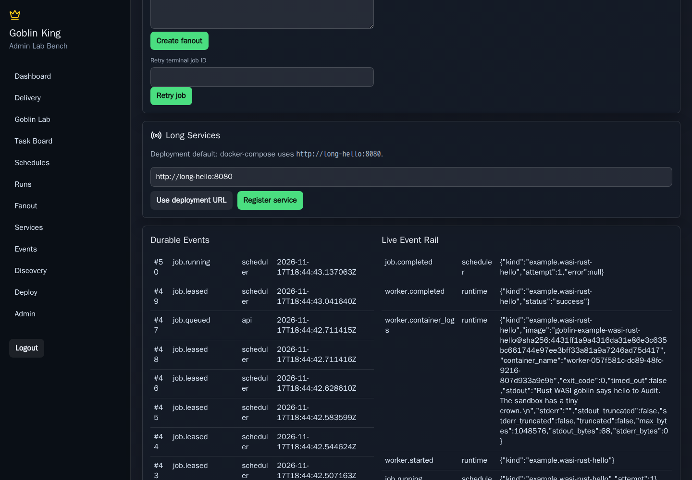
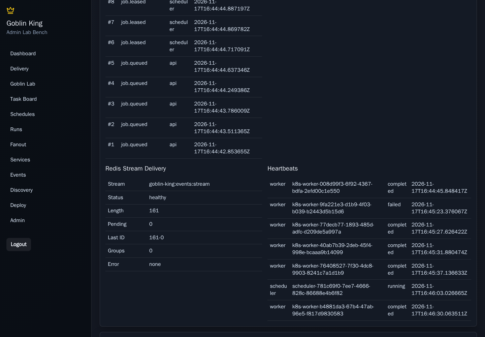
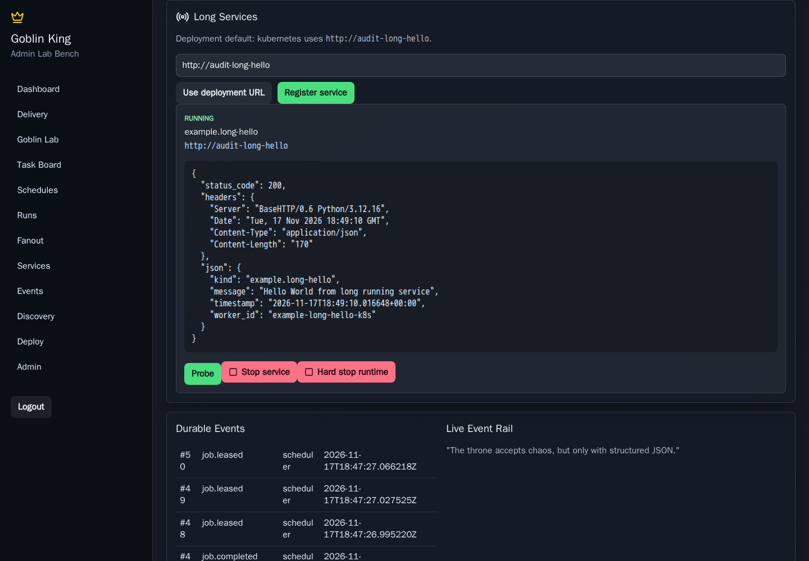
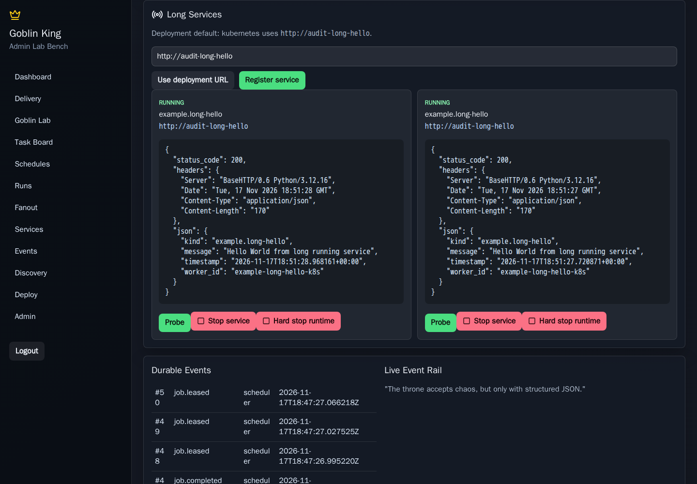

# Local browser acceptance evidence

I exercised the Docker and Helm admin interfaces twice against implementation
`f7c4d3aed056c636d18ebed6f3775420bc5c8eda`. Browsers ran headlessly inside
containers without desktop input. Every registered one-shot kind was submitted
through the UI; the long-running example was checked through Services.

These are browser audit results, not a claim that the complete delivery acceptance
suite has finished. Cluster fault, storage, cleanup and retained-demo results are
reported separately. The delivery fixtures use a local GitHub API simulation;
synthetic reviews do not establish real GitHub review or App-installation evidence.

Helm evidence was verified using the unchanged verifier inside its audit Pod,
where the loopback endpoint is reachable. The packaged preparation helper verifies
CRI OCI-index aliases against the exact node-platform runtime manifest. Raw image
identities, hash checks and preparation attempts remain in the local report.

Only selected screenshots and non-secret execution identities are published here.
Credentials, installation values and full API responses remain outside Git.

## Run one: docker

Acceptance identity: `ec175ed6-c1bf-4406-acc1-f2b9fd0eeb38`.

| Kind | Result | Job | Run |
|---|---|---|---|
| example.artifact | completed | `2bfec1d4-39f0-4661-a019-f6adf823d4b4` | `a37ebd47-83b5-4808-a755-a47be750e397` |
| example.behavior-go-transform | completed | `22f0a27a-4d1b-41ac-a6a7-7ffb24496f07` | `02f1d769-c586-46a1-9c1e-8a53aa25d790` |
| example.behavior-node-artifact | completed | `9896efd2-ec7b-4e92-a3be-ce5db896f580` | `77592aad-465f-4407-9613-c776df76fd54` |
| example.behavior-python-progress | completed | `bef450bb-0748-41b3-ab0f-8bcafd63ff6d` | `c569224f-053c-453d-a6fd-21f4636f8e1e` |
| example.behavior-python-slow-cancellable | completed | `c4577a08-05db-4d0a-ab72-ea17d64c80bc` | `d780b349-6ea2-45ba-b36a-742f5a6472d8` |
| example.behavior-shell-failure | documented controlled failure | `6a3bbda4-54b2-4c66-ac92-203d61d9cddb` | `e927fc5b-88c4-4f77-a596-9743da38a0df` |
| example.behavior-wasi-c-context | completed | `f37865ef-5519-46e7-97ed-234b4ee95628` | `c40037b0-7b44-4a49-b273-426c52cbc0d8` |
| example.controlled-failure | documented controlled failure | `f3b5eb09-c39c-4932-ab6d-01ff47ec672d` | `bebe8129-cd24-4c8a-bf61-4f335f77c4b3` |
| example.echo | completed | `b4db71ad-d0a8-4304-947e-aef577c829fa` | `858f13a0-a2f0-41a2-b36b-a8b5178ec07a` |
| example.environment | completed | `eee58dee-4416-47fa-b5f5-0968a0c6d46a` | `49f85995-6bc3-44b8-9fb7-352fc6da0536` |
| example.hello | completed | `bb25ef6e-1687-412a-8241-2d11f6435331` | `c0ac691a-7abd-4440-96dc-b66ff7705882` |
| example.hello-dotnet | completed | `7a26c960-c95b-404d-a188-2b72ad83dff9` | `d88efa05-24a3-4150-9557-99627defb42b` |
| example.hello-go | completed | `627c5d4f-e7be-48c2-b168-b24d7741658e` | `d83ef65f-fbb1-475d-bdc3-1a8187d0a039` |
| example.hello-java | completed | `4a105a80-fb58-4f9d-a1fa-f4a9b69b0d4a` | `0895e9dc-bdbd-4da7-9763-f16a8199f479` |
| example.hello-node | completed | `8e0a3887-c8d3-4438-8418-6b9e52a6f0ef` | `4f8c4617-091f-4957-a99d-7845b9ae5886` |
| example.hello-php | completed | `f726628f-fe36-44a9-8223-05f47dd9155d` | `fade444d-7ec6-41a7-990d-e68955d5a124` |
| example.hello-python | completed | `86a82022-3c1d-41a6-990d-f5f89f77d96d` | `3e5ebd78-8865-46e7-be99-5dd758f516a2` |
| example.hello-ruby | completed | `38d7b80c-cba1-4c95-9fbe-473906e93b35` | `e88946e6-da52-4c5c-9b5d-96568d0d5549` |
| example.hello-rust | completed | `ffd7cadb-c50e-4610-9149-e01cb3508bfa` | `04dfed7a-40e2-4aa8-8dc2-aa919fd91349` |
| example.hello-shell | completed | `fed65e39-a569-43e3-93f8-ced900cb1d3e` | `e1d481cb-f04c-4d96-9f28-072f383c5ec5` |
| example.progress | completed | `a1e25589-a9d5-4fb8-a01b-a444d9d281aa` | `830e02a1-77f5-4aab-a130-7a159f5b0f09` |
| example.wasi-c-hello | completed | `574263fa-b0f4-4a8a-8e12-ce7db6e616c4` | `c8cbde81-89a0-4a1a-b10b-3160e578a7db` |
| example.wasi-rust-hello | completed | `bf2c46df-1380-45df-a07e-66ea1e31399f` | `057f581c-dc89-48fc-9216-807d933a9e9b` |

I downloaded the returned artifacts and compared their bytes with the authenticated API. Both service probes returned HTTP 200 with advancing timestamps.

## Run one: helm

Acceptance identity: `ec175ed6-c1bf-4406-acc1-f2b9fd0eeb38`.

| Kind | Result | Job | Run |
|---|---|---|---|
| example.artifact | completed | `1d0366e2-87d2-4f93-886a-200be2dd4ddb` | `0647ef05-8c60-4dfe-8439-76487d4d56fb` |
| example.behavior-go-transform | completed | `b18619b9-a9d4-4f16-8e8a-6f34cdf744a6` | `cef99d23-b233-4c4b-896f-a396badac591` |
| example.behavior-node-artifact | completed | `f7592d16-7d34-4e10-92d5-188826b5a943` | `b3a81854-62e4-4069-a68d-25a6033435c8` |
| example.behavior-python-progress | completed | `893da48d-2913-4630-8c89-7c7d0826df81` | `f9fe7933-4e77-44e6-9102-564b019a097c` |
| example.behavior-python-slow-cancellable | completed | `9beafeac-f739-4a1f-8010-98c708079dfb` | `500e3a09-a12e-47d7-827a-1c93f94db837` |
| example.behavior-shell-failure | documented controlled failure | `bea3dc95-18af-484c-a731-0379dbe3c902` | `67f7966a-2d48-4f36-8c60-b200b262e6fa` |
| example.behavior-wasi-c-context | completed | `52c51893-a508-4d42-9dcc-6dfafdf03d7b` | `767a0faf-3a5d-4095-a353-b5f8a36695a9` |
| example.controlled-failure | documented controlled failure | `cb75076e-31e6-474a-bec7-231f3b7f1c7c` | `8376abe5-326d-48b0-af85-43b6a0ae7e62` |
| example.echo | completed | `27c02f8e-81f1-4316-9cc6-5c762aca542b` | `a5f51f0b-b90b-4880-8938-7d2014d0a109` |
| example.environment | completed | `9a50b8a6-458e-40c1-8d46-6b1457dfaaa7` | `6b039bb6-0b25-4617-ae53-75f461b3cceb` |
| example.hello | completed | `bf1de7e4-02ad-45e0-bced-abbe7cef86fb` | `0dbc0bcf-9f6a-4b5b-a44d-233b9991a67a` |
| example.hello-dotnet | completed | `37738ecc-b6f7-4124-b88a-4bd6584f5f9c` | `0dbe9bd5-5e2c-4545-9c51-e7047308973a` |
| example.hello-go | completed | `bec1a323-051b-4aeb-98bb-34ea3fb2f349` | `84d24602-1369-4339-9824-73b030ef2e8a` |
| example.hello-java | completed | `3bd74c06-f262-4124-9957-4d3b377cb006` | `fa45bf78-1f1c-4bd7-a167-4bd8a83a3e29` |
| example.hello-node | completed | `2d38a366-3036-43c7-8dba-a2741e7eb553` | `0f9006f0-baab-4438-9768-06bffde417a3` |
| example.hello-php | completed | `b2d31c8b-41cb-4258-b730-8dc9828aeaf5` | `068bcdc5-e784-4fd6-ade1-b7c52820cfdc` |
| example.hello-python | completed | `c7dfc129-9768-4b4c-8420-65913ef5b34d` | `d8ca08da-f9c5-4337-a347-8984a193c2ec` |
| example.hello-ruby | completed | `26186389-7e8c-4da1-b4c5-a94adc512f87` | `6dc0a0c4-b789-40d9-81ca-9118c2b8fb81` |
| example.hello-rust | completed | `ddc8dcf5-3901-4c18-9b0d-3e08d2530835` | `224604a0-2f41-4dac-8237-5cb7542523be` |
| example.hello-shell | completed | `ac37dac2-b745-49bf-b864-06a94ee277c8` | `e272cb33-7f61-410a-9c0a-016d9eda33b0` |
| example.progress | completed | `53117bc7-3c3b-4fc9-a22a-55682feeb176` | `5f0a10d9-a01f-4798-84ce-3591a38c6e9e` |
| example.wasi-c-hello | completed | `db2f44bd-b3c3-4306-b691-c60638142b2f` | `745924bd-8599-45c4-833a-f0bd6b78fceb` |
| example.wasi-rust-hello | completed | `5e495d6f-8178-4b84-8963-75565f81f81b` | `c7f6975b-6457-4c05-af4c-eb8f9120551a` |

I downloaded the returned artifacts and compared their bytes with the authenticated API. Both service probes returned HTTP 200 with advancing timestamps.

## Run two: docker

Acceptance identity: `50e59391-04f2-4b13-8377-a955508f46b2`.

| Kind | Result | Job | Run |
|---|---|---|---|
| example.artifact | completed | `66054089-af92-4257-be64-bcdc0c943112` | `8c92f880-89d3-4334-b7e7-0ce33803d0ed` |
| example.behavior-go-transform | completed | `0de8d6c5-cced-4891-84ba-4abdbdddb418` | `9bbaa6f9-e66c-46f4-b8b4-b008998a26a3` |
| example.behavior-node-artifact | completed | `5d196314-786e-4a2b-9392-e190f652839b` | `20f76da1-dc8a-44cb-97f2-d03ec9f298d3` |
| example.behavior-python-progress | completed | `9e10a1b3-1782-4ce5-8efa-0e914d574fec` | `2d3445e9-c666-4a73-bc33-47cf4b011362` |
| example.behavior-python-slow-cancellable | completed | `149a31b1-2923-4cba-a578-f28a62e427b3` | `da157bdc-734d-4e2c-b303-30ae216e4729` |
| example.behavior-shell-failure | documented controlled failure | `1233f7da-a593-43b1-917d-e8ebe2369c63` | `de78608d-c39d-448d-a554-06f713737975` |
| example.behavior-wasi-c-context | completed | `abfdcbce-3f4f-48d0-b481-c44d934cfa55` | `93b70548-bfd7-472e-b314-c607dde75c65` |
| example.controlled-failure | documented controlled failure | `26b7ce18-d37b-468f-9893-3293532edf78` | `5665173d-d1c2-4855-a60b-a359b1e937de` |
| example.echo | completed | `40b6b5b3-52c5-4d6f-90e0-cf58c4c38ee1` | `562b7a6c-3b80-44c0-b35e-9ab279317809` |
| example.environment | completed | `5433fb09-9fd6-4935-91e6-8031daa209a7` | `72a19b33-adb0-46c0-939d-3f52946e012d` |
| example.hello | completed | `a68f4b64-057b-4780-930f-efa82cd7fae9` | `e74a244d-b34c-40a1-bc6c-55332f1ab5fb` |
| example.hello-dotnet | completed | `1bb24886-8b1e-41b0-8353-fe09de69304b` | `d632756b-92e7-4412-967a-a87503b4c205` |
| example.hello-go | completed | `b1bb0191-6f87-4194-a912-0d8ee72c1bbb` | `5a0dc8a4-639a-4c41-bf02-e5eae4ed62fd` |
| example.hello-java | completed | `b2ce9bcd-7153-4c6e-bcd1-cfabfdd81c05` | `01cce7fd-357c-48af-976b-585b842cb10f` |
| example.hello-node | completed | `8de9b34c-36fe-4655-9c3e-0e058da7365e` | `fb5725bb-6733-4c7c-8518-ab98f420001d` |
| example.hello-php | completed | `e366ba64-bb17-4014-a8ef-077111614cb1` | `0c61abcd-9a05-470e-a751-02556d5b0532` |
| example.hello-python | completed | `e7146c24-e948-4a62-b387-4b67f8464ea5` | `7f6c4438-3d11-451e-966c-b8e7f7ebfdab` |
| example.hello-ruby | completed | `a4c94da4-4c50-45f9-b110-e9a6aecc6bc1` | `64236a2e-39c7-4bb8-9765-dd4d840e17df` |
| example.hello-rust | completed | `a0985873-7463-492d-aaff-e8ff8644a4e0` | `50446dc9-f1ba-495b-a826-d9777894e9a7` |
| example.hello-shell | completed | `ebbc6515-4592-4db6-b5cf-83fe1e7e1e75` | `ad557308-2bd2-4397-8ff0-21282f41a9ac` |
| example.progress | completed | `c47b0a6e-09d9-4f25-9aaa-076815e961fc` | `2ee885fe-13f0-42d8-bfeb-41e420a5bfec` |
| example.wasi-c-hello | completed | `8eb93129-53ef-42a5-bf55-43f0efdc4312` | `bb72b36e-6063-4c35-9784-922d5c8f3b8d` |
| example.wasi-rust-hello | completed | `735c18d9-418a-42bb-9752-d12beff5e69d` | `1abd9650-e479-4c46-9425-98d9df0e53ae` |

I downloaded the returned artifacts and compared their bytes with the authenticated API. Both service probes returned HTTP 200 with advancing timestamps.

## Run two: helm

Acceptance identity: `50e59391-04f2-4b13-8377-a955508f46b2`.

| Kind | Result | Job | Run |
|---|---|---|---|
| example.artifact | completed | `76d76a36-b8ca-487b-a66d-9de0fe65feec` | `587e42a0-b85b-4ddc-a0b8-5cfc8183220f` |
| example.behavior-go-transform | completed | `231bc8a3-0c51-4528-8cd8-76abd2705276` | `e1b4990c-74c2-491c-ab61-f56e3e30752a` |
| example.behavior-node-artifact | completed | `713a5b8f-11a2-4c44-bfd0-e5496c7f03ab` | `03c2a9ed-55d8-4b62-b287-06bd6ca8b645` |
| example.behavior-python-progress | completed | `9063be6f-944b-4eb7-a2a7-23fe13f6f59e` | `096c2115-26b8-44ae-993f-a1fc996c7973` |
| example.behavior-python-slow-cancellable | completed | `ff54a5ed-640e-492f-94b1-7757bb4669d7` | `2058b08b-9503-4dab-aa3f-f53488e4ae92` |
| example.behavior-shell-failure | documented controlled failure | `1ac8278b-ec95-4058-89ae-305477beb774` | `493d8ada-1ffa-4a9a-8cdf-28d69b7b3dd0` |
| example.behavior-wasi-c-context | completed | `afbd08b9-665a-4efb-a1cb-4bf14118d963` | `7d0635ba-0583-4377-8948-e679334e3406` |
| example.controlled-failure | documented controlled failure | `3f500056-3b1d-4d61-99aa-4b73117a9c26` | `60f4dfa7-9865-4b00-be26-e01981a3a812` |
| example.echo | completed | `79c133b2-186a-4cf1-a3e1-07eccd88fd49` | `9fed0319-cc75-480c-8133-0536f0efc199` |
| example.environment | completed | `294db392-a482-4d23-8c2d-1fec85b0b987` | `ed6cd251-b931-4db5-afde-5af6a8942b1d` |
| example.hello | completed | `c6fd30f5-c0df-4ee6-8efc-ab58ac254f85` | `92c5a7ee-7087-4222-8ac5-7bf5e3d7585b` |
| example.hello-dotnet | completed | `836f8ebc-fd51-4c61-bfe0-d9eb960925cc` | `ed5c5c16-b059-4a81-af95-8516d1e8233c` |
| example.hello-go | completed | `db9db7ad-0844-4e87-ad10-80eca7e6297a` | `c1fae121-791a-468a-bff1-b2f663f86c63` |
| example.hello-java | completed | `86871ece-5a45-4795-9d1c-369a9298686f` | `bdf2baef-30d2-4dbf-a6a9-104c3b0a254f` |
| example.hello-node | completed | `d7c72db1-55bc-467f-9297-ffb89c962a4a` | `66dc2f98-6678-498a-bdd4-0c34d693d41d` |
| example.hello-php | completed | `74190fa4-0ea2-490c-a2ff-9b78c5d54d17` | `0ff62030-746d-4f5a-9e0e-8911e8982f7e` |
| example.hello-python | completed | `821416f3-5064-4aeb-a436-bd785129a4a5` | `7e262ed6-3fc3-44e8-b77f-c6cefcc5380f` |
| example.hello-ruby | completed | `70d6e49f-18b1-41e2-b16f-df5a4b063e9c` | `bfc21170-9bd2-43bf-8ff8-d4b1f40358c2` |
| example.hello-rust | completed | `c5f90ffb-fd39-4edf-bb09-03ddb3e2d70c` | `f70de441-4778-4b67-899d-2a7ad34bb806` |
| example.hello-shell | completed | `f459e3b9-85fa-430e-8a8d-96d7ec16b802` | `bffc1b60-e987-4c19-8910-aabd334dff83` |
| example.progress | completed | `69446f84-455a-4ba3-825c-5795707ad127` | `fcb1ba2c-9c3c-424f-9edf-78201bff111f` |
| example.wasi-c-hello | completed | `d7760f66-26fc-498f-8159-bf47d36e3638` | `6d598a37-9a14-408f-b56c-95cc4dc522ce` |
| example.wasi-rust-hello | completed | `89a5dbd4-3011-4aab-973c-746b4f5c74be` | `0def56e8-5382-44b4-ae94-d3039f401cc2` |

I downloaded the returned artifacts and compared their bytes with the authenticated API. Both service probes returned HTTP 200 with advancing timestamps.

