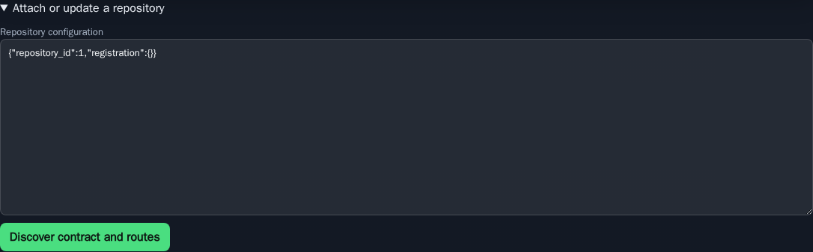
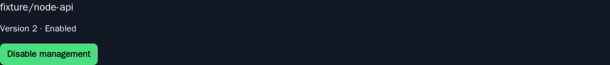
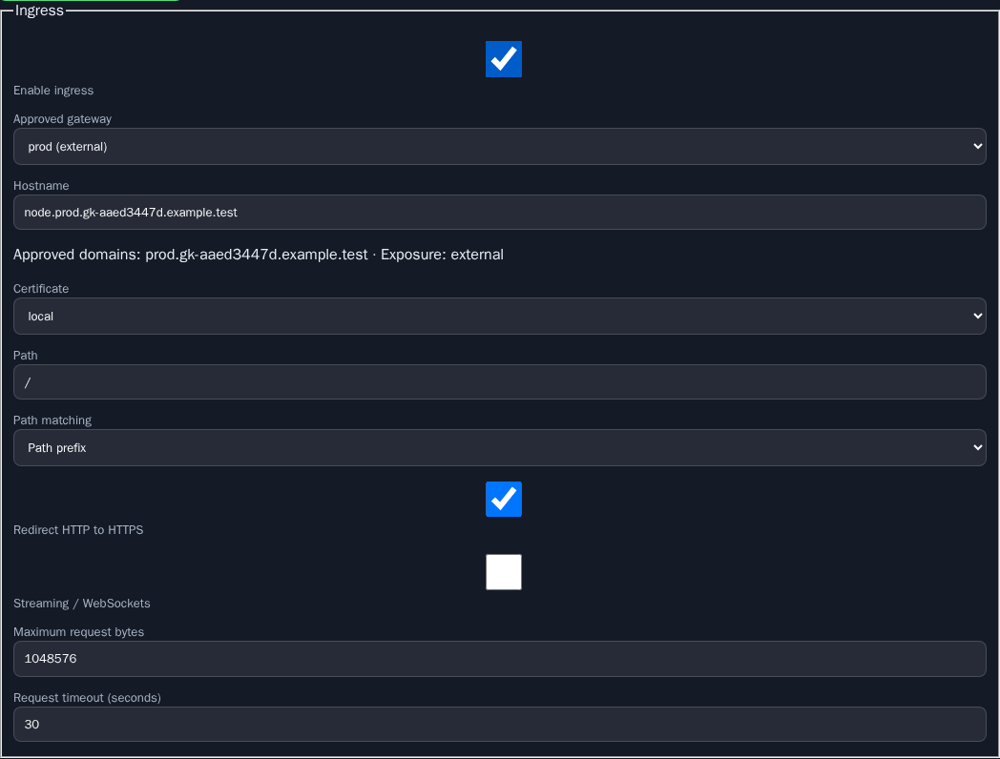
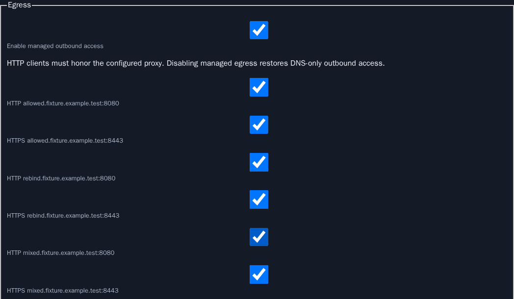

# Deploy a service from a GitHub repository

This walkthrough connects an existing HTTP service to Goblin King, then uses
reviewed changes on `test` and `main` to test, build and deploy it automatically.
The service builds from a `Dockerfile` at the repository root. Optional ingress
provides an HTTPS route; optional egress controls the destinations it can call.

The resulting flow is:

```text
Reviewed PR → merge to test → exact-commit tests → immutable image
            → test deployment → health checks → release-state Git record

Reviewed PR → merge to main → exact-commit tests → immutable image
            → production deployment → health checks → release-state Git record
```

Each branch merge is tested and built at its own exact commit. This is not an
automatic promotion of the test image into production. Ordinary direct pushes and
unreviewed changes are not eligible delivery events.

The screenshots show the real admin UI against local fixture repositories.
`fixture/node-api`, the `.example.test` hostnames and the displayed namespace names
are demonstration identities. They are not GitHub installation instructions or
values to copy into another installation. Real GitHub App installation and genuine
review enforcement are separate from the locally simulated acceptance evidence.

## 1. Prepare the platform once

Start with an installed, authenticated Goblin King control plane and admin UI.
Use the [Helm installation instructions](../README.md#kubernetes-and-helm),
[execution profile](pipeline-execution.md), and
[storage configuration](pipeline-storage.md) for the platform installation.
The supported delivery topology has one active SQLite storage node. Application
and build execution may use other nodes; this is not a highly available database.

Before attaching a repository, prepare these installation-owned choices:

| Choice | Example / requirement |
| --- | --- |
| Project | `shop`, with project or administrator access |
| Application repository | `OWNER/REPOSITORY` and its numeric GitHub repository ID |
| Release-state repository | A separate `OWNER/RELEASE-STATE` repository and numeric ID |
| Branch routes | `test` → test; `main` → production |
| Namespaces | Separate source/build, test application and production application namespaces |
| Registry | Trusted TLS, immutable release tags, scoped publication credentials and separate approved image paths |
| Runtime profile | `http-service-v1`, with approved storage, Secret references and resource bounds |
| Installation images | Controller, build, deployment, networking and admin images pinned by digest |
| Network choices | Optional approved Gateways, certificate aliases, hostnames and outbound destinations |

The platform configuration must include the repository in
`pipeline.workerConfig.sources`, its destinations in
`pipeline.workerConfig.releases`, and matching namespace/registry bounds in
`pipeline.settings`. Source and application namespaces must be different.
Discovery rejects destinations that do not match these installed bindings.
Adding another repository requires another configuration entry and its scoped
credentials, not a change to Goblin King's implementation.

Keep actual installation values, private keys and passwords outside Git. Store
credentials in Kubernetes Secrets and use the chart's `pipeline.authSecret`,
`pipeline.githubSecret` and `pipeline.registryReaderSecret` references. Install
the approved values through Helm, for example:

```powershell
helm upgrade --install delivery ./charts/goblin-king `
  --namespace delivery-system --create-namespace `
  --values /path/to/private/approved-delivery-values.yaml --wait
```

That values file is a complete installation configuration, not the repository
registration used later in this guide. The chart's default values leave delivery
disabled. Do not enable it by merely changing the single `enabled` flag: image
approvals, execution definitions, RBAC, registry access and isolated namespaces
must also be installed and validated. See the
[chart values](../charts/goblin-king/values.yaml) and the
[local installation/acceptance procedure](pipeline-local-acceptance.md) for the
Docker Desktop environment.

Verify actual allowed and denied connections through the cluster's NetworkPolicy
implementation. Its policy processes must remain healthy and have enough memory
for the retained execution evidence. An installed policy manifest alone does not
prove enforcement.

## 2. Connect the GitHub App and protect the branches

Create a GitHub App for the account or organization that owns the repositories.
Install it only on the application repositories and the separate release-state
repository that this installation will manage. GitHub documents
[App registration](https://docs.github.com/en/apps/creating-github-apps/registering-a-github-app)
and [permission selection](https://docs.github.com/en/apps/creating-github-apps/registering-a-github-app/choosing-permissions-for-a-github-app).

For the current adapter, configure these repository permissions:

| Permission | Access | Purpose |
| --- | --- | --- |
| Contents | Read and write | Read application source; write observed state to the separate release-state repository |
| Pull requests | Read | Verify the merged PR and current approving reviews |
| Administration | Read | Read branch-protection requirements |
| Metadata | Read | Verify repository identity |

The source-read installation tokens are restricted to one repository and read
permissions. Recording uses a separate repository-scoped token with Contents
write access. Application tests do not receive these tokens.

Enable the App's **Push** webhook and set its URL to the installation's public
HTTPS endpoint ending in `/pipeline/webhooks/github`. Set a webhook secret and
store the same value, together with the generated App private key, in the
referenced Kubernetes Secret. Its keys are `private-key.pem` and `webhook-secret`.
Record the numeric App ID and installation ID in the installation configuration.
See GitHub's [webhook setup](https://docs.github.com/en/apps/creating-github-apps/registering-a-github-app/using-webhooks-with-github-apps).

For a local cluster, use a relay that forwards only the signed webhook endpoint.
Keep the admin UI and the rest of the API authenticated and off that public relay.
Polling reconciles eligible missed events every 60 seconds and at startup, through
the same authorization path as webhooks.

Set these values for a real GitHub installation in both the API configuration and
its matching source-access configuration:

```yaml
pipeline:
  settings:
    simulated_provider: false
    acceptance_faults: false
    provider_url: https://api.github.com
    app_id: APP_ID
    installation_id: INSTALLATION_ID
    reconcile_seconds: 60
    release_repository: OWNER/RELEASE-STATE
    release_repository_id: RELEASE_STATE_REPOSITORY_ID
  workerConfig:
    acceptance_faults: false
    provider:
      simulated_provider: false
      provider_url: https://api.github.com
      app_id: APP_ID
      installation_id: INSTALLATION_ID
```

This is the GitHub-specific portion of the installation values; merge it into the
complete approved configuration from step 1. Replace the ID placeholders with
numbers. Use an initialized release-state repository with its `main` branch
available for normal, non-force Git updates.

Create `test` and `main` in the application repository. Configure branch-protection
rules for **both** branches with:

- Pull requests required before merging, with at least one approving review.
- Stale approvals dismissed when new commits are pushed.
- Approval required for the most recent reviewable push.
- Protection enforced for administrators, with force pushes disabled.

The adapter verifies these properties through GitHub's branch-protection API;
rulesets alone are not a substitute for that API response in the current adapter.
Approvals must cover the PR's current head, come from someone other than its
author, and leave no outstanding changes-requested review. Use normal reviewed
merges through GitHub. GitHub explains the settings in
[protected branches](https://docs.github.com/en/repositories/configuring-branches-and-merges-in-your-repository/managing-protected-branches/about-protected-branches).

## 3. Make the repository buildable from its root

The repository needs:

```text
repository/
├── Dockerfile
├── pipeline-service.json
├── application source
└── tests
```

Keep the existing root Dockerfile. Add a named `test` stage if it does not already
have one, and keep the runnable service as the final stage. For example:

```dockerfile
FROM python:3.12-alpine AS base
WORKDIR /app
COPY app.py ./
USER 65532:65532

FROM base AS test
COPY test_app.py ./
CMD ["python", "-m", "unittest", "-v"]

FROM base AS runtime
EXPOSE 8080
CMD ["python", "app.py"]
```

Adapt the dependency installation and files to the service. The HTTP process must
listen on `0.0.0.0`, use the declared port, and return HTTP 200 at the declared
health path when ready. The example does not supply an application implementation.
The installed service runs as UID/GID `65532` with a read-only root filesystem.
Use `/tmp` for temporary files and `/data` for application data; enable approved
persistent storage when that data must survive replacement.

Add `pipeline-service.json` beside the Dockerfile:

```json
{
  "apiVersion": "goblin-king/pipeline-service/v1alpha1",
  "kind": "PipelineService",
  "context": ".",
  "dockerfile": "Dockerfile",
  "test_target": "test",
  "test_command": ["python", "-m", "unittest", "-v"],
  "port": 8080,
  "health_path": "/health"
}
```

Omitting `runtime_target` selects the final Dockerfile stage. An explicit named
runtime target is also supported. The test command is an argument array, not an
implicit shell command. Optional `background_command` and `scheduled_command`
arrays declare additional activity; persistent storage and schedule settings stay
within the installation's approved deployment profile.

Verify locally from the repository root:

```powershell
docker build --target test -t service-test .
docker run --rm service-test python -m unittest -v
docker build -t service-runtime .
docker run --rm -p 8080:8080 service-runtime
# From another terminal:
curl.exe --fail http://127.0.0.1:8080/health
```

Use the service's actual test command. Put the contract and Dockerfile on both
managed branches before onboarding. The
[Python](../examples/pipeline/fixtures/python-api) and
[Node](../examples/pipeline/fixtures/node-api) fixtures provide complete examples;
their controlled-upstream certificate is specific to the local acceptance fixture.

## 4. Discover, attach and enable the repository

Open the installed admin URL, authenticate, and find **Repositories / Delivery**.
Enter the project, then choose **Inspect delivery**. Expand **Attach or update a
repository**.



Paste a registration using the actual numeric repository ID, approved destinations
and installed revisions. This example maps the two branches independently:

```json
{
  "repository_id": 123456789,
  "registration": {
    "project_id": "shop",
    "service_id": "web",
    "source_repository": "owner/repository",
    "pipeline_revision": "REPLACE_WITH_INSTALLED_40_CHARACTER_GIT_SHA",
    "catalog_revision": "REPLACE_WITH_APPROVED_40_CHARACTER_CONFIG_SHA",
    "environments": [
      {
        "name": "test",
        "branch": "test",
        "target": "local",
        "namespace": "shop-web-test",
        "release": "web",
        "deployment_profile": "http-service-v1",
        "image_repository": "registry.example.com/shop/web/test",
        "active": true
      },
      {
        "name": "prod",
        "branch": "main",
        "target": "local",
        "namespace": "shop-web-prod",
        "release": "web",
        "deployment_profile": "http-service-v1",
        "image_repository": "registry.example.com/shop/web/prod",
        "active": true
      }
    ]
  }
}
```

Replace every example value; the literal revision placeholders are deliberately
invalid. Source repository names are normalized lowercase. The installed pipeline
revision and approved configuration revision are full Git SHAs, not branch names.

Choose **Discover contract and routes**. Check the repository ID, both branch
heads, review policy, Dockerfile targets, test command, namespaces and image paths.
Resolve every error before choosing **Attach reviewed configuration**. Attachment
starts with management disabled. Choose **Enable management** on the repository.



**Attaching and enabling do not deploy existing branch heads.** They establish the
starting cursor. A new eligible reviewed merge after enablement starts delivery.

The equivalent authenticated CLI uses the same API. Set `GOBLIN_KING_API_URL` to
the API base URL and provide `GOBLIN_KING_API_TOKEN` through the environment or a
secret manager, not a command-line token value:

```powershell
goblin-king pipeline status
goblin-king pipeline discover /path/to/private/registration.json
goblin-king pipeline attach /path/to/private/registration.json --idempotency-key attach-web-1
goblin-king pipeline inspect repositories --project shop
goblin-king pipeline management REPOSITORY_KEY true EXPECTED_VERSION enable-web-1
```

Use the returned key and current version. A stale version requires reinspection;
retries of the same intended action reuse its idempotency key.

## 5. Merge a change and verify the running service

Open a PR against `test`, obtain a fresh approving review and merge it. In
**Repositories / Delivery**, inspect **builds**, **operations** and the test release.
The pipeline checks out the exact approved commit, runs its tests, publishes an
immutable image only after success, deploys its digest and verifies health.

Confirm all of the following before promoting the change:

| Observation | Where to check |
| --- | --- |
| Exact merged commit and successful tests | Build details and retained test evidence |
| Published digest and provenance | Build result |
| Desired and observed release state | Release card and **Release evidence** |
| Completed rollout and healthy service route | Operation and release health evidence |
| Matching observed Git record | Separate release-state repository |

For an internal-only service, use a local port-forward to its Service and check the
health endpoint; this does not make it public:

```powershell
kubectl -n shop-web-test port-forward service/web 8080:8080
# From another terminal:
curl.exe --fail http://127.0.0.1:8080/health
```

Then open and review a PR into `main`. Its exact merged commit is tested and built
for the separate production route. Verify the production release and Git record
the same way. A delayed older build cannot replace a newer desired revision.

## 6. Add optional HTTPS ingress

Ingress and egress are independent and disabled by default. For ingress, the
installation must first provide a managed or approved existing Gateway, certificate
alias, allowed hostname and external-exposure permission. Install and preflight
the optional package using the [networking guide](pipeline-networking.md).

In **Networking: ingress and egress**, select the release and choose **Inspect
networking**. Enable ingress, choose the approved Gateway and certificate, enter
the approved hostname, and select the path, redirect, request limit and timeout.
Enable streaming/WebSockets only where the service needs it.



Choose **Preview networking changes**, review the normalized configuration, then
**Apply networking changes**. Wait for the returned operation to complete. Choose
**Probe networking health** and inspect **Observed networking** and diagnostics.
The application image is reused; changing a route does not rebuild the application.

For public access, point DNS at the reachable Gateway address and configure the
required load balancer or NodePort, firewall and certificate trust. Verify the
hostname from outside the cluster. A successful cluster probe or Docker-network
probe is not proof that the public Internet can reach it. Existing Gateways and
their certificates remain operator-owned.

## 7. Configure outbound access independently

In the same form, enable managed outbound access and select approved hostname,
protocol and port combinations. Preview and apply the change as a separate
versioned operation.



The application must use the supplied HTTP/HTTPS proxy environment variables.
Confirm that its HTTP client actually honors them; applications with custom clients
may need proxy support configured in the application. HTTPS CONNECT authorizes the
destination and port without intercepting encrypted traffic.

Approved direct TCP/UDP destinations are separate CIDR/port choices. They do not
make the forward proxy public or promise a fixed public source IP. Unapproved
destinations, protected cluster addresses, other environments' proxies and direct
bypasses remain denied by the installed policy. Disabling managed egress removes
those approved outbound paths and returns to the baseline DNS-only outbound policy.

Test a permitted request and a denied request from the actual service. Also verify
background and scheduled activity if those commands are declared. Tightening the
policy terminates existing application/proxy connections before activity resumes.

## 8. Operate test and production deliberately

| Action | Result |
| --- | --- |
| **Deactivate test** | Stops service/background activity, suspends schedules and settles active scheduled Jobs; keeps data |
| Merge while test is inactive | Tests and publishes a verified image while the environment remains inactive |
| **Activate newest verified build** | Selects the newest verified build and restores activity and configured routes |
| **Disable management** | Stops admitting new automatic repository delivery; does not stop an already running application |
| **Emergency rollback** → **Restore … and hold delivery** | Restores a known healthy release and leaves a durable hold |
| **Clear release hold** | Explicitly permits delivery to advance again after the hold is reviewed |
| **Rebuild as a new attempt** | Creates a new build UUID; it is not a retry of Git recording |

A failed rollout restores and verifies the previous healthy release. A failed
first install has no previous release to restore. A failed route change can restore
an authorized healthy ingress route while preserving newly tightened egress.
Ambiguous resource identity, configuration or interrupted execution remains held.

If rollout succeeded but Git recording failed, keep the healthy observed release
and repair recording. Do not rebuild or redeploy to repair a Git outage. For held
operations, inspect the reason and use **Verify termination and reconcile release**
or the documented [recovery commands](pipeline-releases.md). A lease timeout alone
does not permit another deployment.

## 9. Add another repository and retain proof

Give the second repository its own source namespace, scoped registry paths, test
and production destinations, and App access. Repeat discovery and attachment with
a different service ID. The same installed implementation handles both repositories
through configuration.

Retain the merged commit, build ID, image digest, operation ID, health evidence and
release-state Git record for each environment. Use the
[complete local acceptance procedure](pipeline-local-acceptance.md) and
[networking acceptance procedure](pipeline-networking.md#complete-local-acceptance)
to validate an installation. Those reports identify the verified revision and
runtime evidence; screenshots illustrate the controls and are not a substitute for
the complete cluster tests or genuine GitHub reviews.
